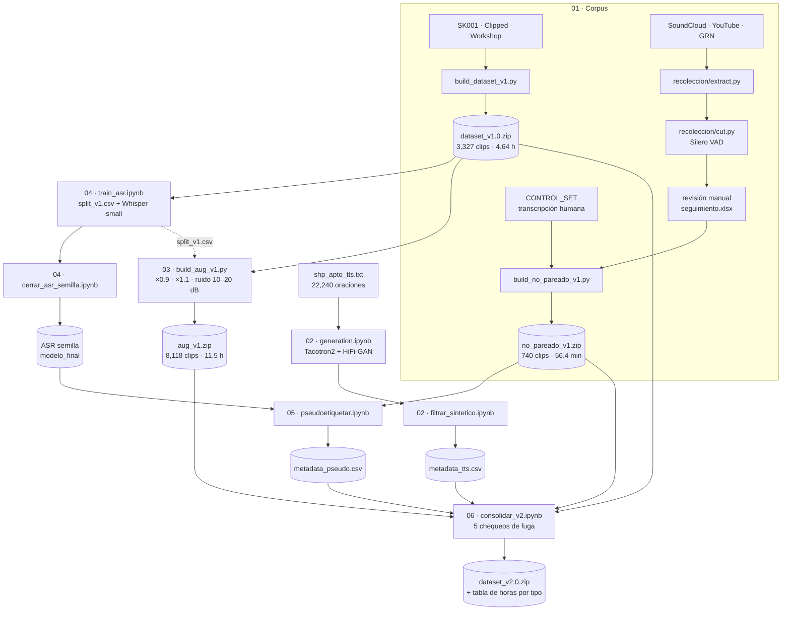

# Datos sintéticos para ASR en Shipibo-Konibo

Código de la tesis *Generación de datos sintéticos para el entrenamiento de sistemas ASR en Shipibo-Konibo*
(Daniel Malca López, PUCP). Cubre el flujo completo: armado del corpus, síntesis de voz (TTS), aumento de audio,
pseudoetiquetado, entrenamiento y comparación de modelos ASR, y la demo del modelo final.

El trabajo tiene dos etapas:

1. **Etapa preliminar** (scripts locales + notebooks de Colab): corpus base, ASR semilla (Whisper small), síntesis de
   la mitad de las frases con Tacotron 2, aumento, primera versión de las pseudoetiquetas y corpus ampliado **v2.0**.
   Es lo que describen el diagrama y la tabla de pasos de abajo.
2. **Etapa final** (scripts de Python en un servidor con GPU): síntesis completa con dos TTS (Tacotron 2 y MMS-TTS),
   texto de AmericasNLP, los 43 modelos ASR de los escenarios comparativos (MMS-1b-all y Whisper), modelos de
   lenguaje, pseudoetiquetas finales, elección del modelo final y demo. Ver [Etapa final](#etapa-final-servidor).

Los datos no viven en el repositorio (son GB de audio): los scripts locales leen y escriben en la carpeta
`SHIPIBO_DATOS` y los notebooks de Colab en Google Drive. Cada paso deja un `config.json` con sus parámetros,
versiones y huellas sha256, que funciona como registro automático del experimento.

## Flujo



## Pasos

| # | script | dónde corre | entrada | salida | parámetros clave |
|---|---|---|---|---|---|
| 01 | [`build_dataset_v1.py`](01_corpus/build_dataset_v1.py) | local | SK001, Clipped, DatasetWorkshop | `dataset_v1.0/` + `.zip` | 16 kHz mono; solo workshop con check auditivo = SI |
| 01 | [`build_dataset_v1_1.py`](01_corpus/build_dataset_v1_1.py) | local | `dataset_v1.0`, `split_v1.csv`, workshop aprobado después | `dataset_v1.1/` + `.zip`, `split_v1.1.csv` | v1.0 congelada + 4 clips; split por grupo de hablante |
| 01 | [`recoleccion/extract.py`](01_corpus/recoleccion/extract.py) | local | `links.txt` | un WAV por enlace | yt-dlp |
| 01 | [`recoleccion/cut.py`](01_corpus/recoleccion/cut.py) | local | audio largo | clips de 2–6 s + `manifest.csv` | Silero VAD, umbral 0.5, pausa de unión 0.40 s |
| 01 | [`build_no_pareado_v1.py`](01_corpus/build_no_pareado_v1.py) | local | `seguimiento.xlsx` ×3, `CONTROL_SET/transcripcion.xlsx` | `no_pareado_v1/` + `.zip` | excluye *eliminar* y *edicion* |
| 02 | [`generation.ipynb`](02_tts/generation.ipynb) | Colab GPU | Tacotron2 SKF2, HiFi-GAN, `shp_apto_tts.txt` | `audio_generado/` + `manifest.csv` | SEED 1234, ≤20 palabras/frase, `N_MAX` |
| 02 | [`filtrar_sintetico.ipynb`](02_tts/filtrar_sintetico.ipynb) | Colab CPU | `audio_generado/`, `dataset_v1.0.zip`, `split_v1.csv` | `metadata_tts.csv`, `resumen_filtrado.csv` | voz ≥ 50 %, seg/carácter en p1–p99 de SK001 |
| 03 | [`build_aug_v1.py`](03_aug/build_aug_v1.py) | local | `dataset_v1.0/`, `split_v1.csv` | `aug_v1/` + `.zip` | SEED 1234, ×0.9/×1.1, SNR U(10, 20) dB |
| 04 | [`train_asr.ipynb`](04_asr/train_asr.ipynb) | Colab GPU | `dataset_v1.0.zip`, `shp_apto_tts.txt` | `split_v1.csv`, checkpoints | whisper-small, LR 1e-5, batch 32, SpecAugment |
| 04 | [`cerrar_asr_semilla.ipynb`](04_asr/cerrar_asr_semilla.ipynb) | Colab GPU | checkpoints | `modelo_final/`, `tabla_resultados.csv` | mejor checkpoint por WER en dev |
| 05 | [`pseudoetiquetar.ipynb`](05_pseudo/pseudoetiquetar.ipynb) | Colab GPU | `no_pareado_v1.zip`, `modelo_final/` | `metadata_pseudo.csv`, `eval_control.json` | top 70 % por log-prob, cps p0.5–p99.5 |
| 06 | [`consolidar_v2.ipynb`](06_consolidar/consolidar_v2.ipynb) | Colab CPU | todo lo anterior | `dataset_v2.0.zip`, `stats_v2.0.md` | 5 chequeos; falla = no escribe |

Detalle de cada paso en el `README.md` de su carpeta. Orden de ejecución y rutas exactas: [docs/guia_ejecucion.md](docs/guia_ejecucion.md).

## Etapa final (servidor)

| paso | script | qué hace |
|---|---|---|
| texto | [`02_tts/texto_americasnlp.py`](02_tts/texto_americasnlp.py) | limpia el lado shipibo de AmericasNLP 2021 (15,002 oraciones; 14,494 frases para el TTS) |
| síntesis | [`02_tts/servidor/`](02_tts/servidor/) | `generar_tacotron.py` completa las frases que no se generaron en Colab, `unir_tacotron.py` une las dos mitades y `generar_mms.py` sintetiza todo con MMS-TTS (`facebook/mms-tts-shp`) |
| filtrado | [`02_tts/servidor/cola_filtrado.sh`](02_tts/servidor/cola_filtrado.sh) | `filtrar_tts.py`: mismos filtros que la etapa preliminar + ida y vuelta con dos ASR (CER ≤ 40 %), exporta a 16 kHz |
| evaluación y modelos | [`04_asr/fase_A/`](04_asr/fase_A/) | conjunto de evaluación fijo, fases A, C, D y E, modelos de lenguaje, tablas y métricas relajadas (ver su README) |
| pseudoetiquetas finales | [`05_pseudo/pseudoetiquetar_v2.py`](05_pseudo/pseudoetiquetar_v2.py) | pseudoetiqueta con el mejor modelo según dev + acuerdo con Whisper medium y arma los pliegues por video (lo lanza `cola_D.sh`) |
| evaluación perceptual | [`02_tts/muestra_mos.py`](02_tts/muestra_mos.py) | muestra de 30 audios + 2 de práctica con códigos anónimos para el formulario MOS/IR |
| demo | [`07_demo/`](07_demo/) | página web local (FastAPI) con el modelo final; ver su `LEEME.md` |

Las decisiones de diseño del experimento (D01…D31), con su motivo, están en [docs/decisiones.md](docs/decisiones.md).

## Estructura

```
01_corpus/        corpus pareado v1.0/v1.1 y corpus no pareado v1 (+ recolección y corte con VAD)
02_tts/           voz sintética: notebooks de Colab y servidor/ (Tacotron 2 y MMS-TTS), filtrado, texto AmericasNLP
03_aug/           aumento de audio offline (solo train)
04_asr/           ASR semilla (Colab) y fase_A/ (escenarios comparativos, LM y análisis en el servidor)
05_pseudo/        pseudoetiquetado del no pareado (versión 1 en Colab, versión final en el servidor)
06_consolidar/    corpus ampliado v2.0 con chequeos de fuga
07_demo/          demo local del modelo final (R8)
configs/          huellas sha256 y parámetros de referencia
docs/             guía de ejecución, decisiones metodológicas y tabla para la tesis
```

Cada notebook es autocontenido: su celda 4 escribe en Colab los módulos que usa (`asr_core.py`, `tts_core.py`,
`tts_filtro.py`, `pseudo_core.py`) con `%%writefile`.

## Requisitos

- **Local** (Python 3.12): `pip install -r requirements.txt` y `ffmpeg` en el PATH (solo para `extract.py`).
- **Colab**: cada notebook instala sus versiones fijas en su celda 3:
  `transformers==5.17.0`, `accelerate==1.15.0`, `jiwer==4.0.0`, `silero-vad`, `gdown`.
- **Modelo ASR**: `openai/whisper-small`, revisión `973afd24965f72e36ca33b3055d56a652f456b4d`.
- **TTS**: `rmcpantoja/tacotron2@0b33108` y `justinjohn0306/hifi-gan@11a1788` (commits fijados en `generation.ipynb`).

## Datos y rutas

| dónde | qué |
|---|---|
| `SHIPIBO_DATOS` (local, por defecto `D:\tesis\Code`) | `SK001/`, `Clipped/`, `DatasetWorkshop-…/`, carpetas del no pareado, `CONTROL_SET/`; aquí se escriben `dataset_v1.0/`, `no_pareado_v1/`, `aug_v1/` y sus zips |
| Drive `TESIS/modelo_tts/` | `SKF2` (Tacotron2), `g_00000000` (HiFi-GAN), `shp_apto_tts.txt` |
| Drive `TESIS/asr/` | zips del corpus, `split_v1.csv`, `whisper_small_base/`, `pseudo_v1/`, `dataset_v2.0.zip` |
| Drive `TESIS/audio_generado/` | audio sintético, `manifest.csv`, `metadata_tts.csv`, `filtrado/` |

Los notebooks traen por defecto `MyDrive/TESIS/…`; si la carpeta está en otro lugar (p. ej. `MyDrive/TESISOTA/TESIS`)
se cambia en la celda 1.

## Reproducibilidad

- **Semillas fijas** (1234) en partición, generación TTS (semilla por frase derivada de su id), aumento
  (semilla por clip derivada de id + tipo) y entrenamiento. Regenerar da el mismo audio, verificado byte a byte.
- **Partición fija** `split_v1.csv`: la crea `train_asr` una vez y todos los pasos la reutilizan;
  ninguna frase de dev/test aparece en train ni en el texto del TTS.
- **Huellas sha256** de dataset, texto, modelos y partición en cada `config.json` y en
  [configs/huellas_sha256.txt](configs/huellas_sha256.txt). Para verificar un archivo:

  ```powershell
  Get-FileHash dataset_v1.0.zip -Algorithm SHA256      # o en Colab/Linux: sha256sum dataset_v1.0.zip
  ```
- **Reanudable**: generación, filtrado, pseudoetiquetado y entrenamiento continúan donde quedaron si Colab se desconecta.

## Licencias de los datos

Detalle por fuente en [01_corpus/recoleccion/fuentes.csv](01_corpus/recoleccion/fuentes.csv). En resumen: SK001 cedido por
Menéndez & Gómez (2025); workshop, grabación propia; YouTube y SoundCloud públicos con derechos reservados
(uso académico, sin redistribuir el audio); Palabras de Vida (Global Recordings Network); texto del TTS derivado de
Bustamante, Oncevay & Zariquiey (2020); ruidos del aumento de OpenSLR 28 / MUSAN (Apache 2.0).
